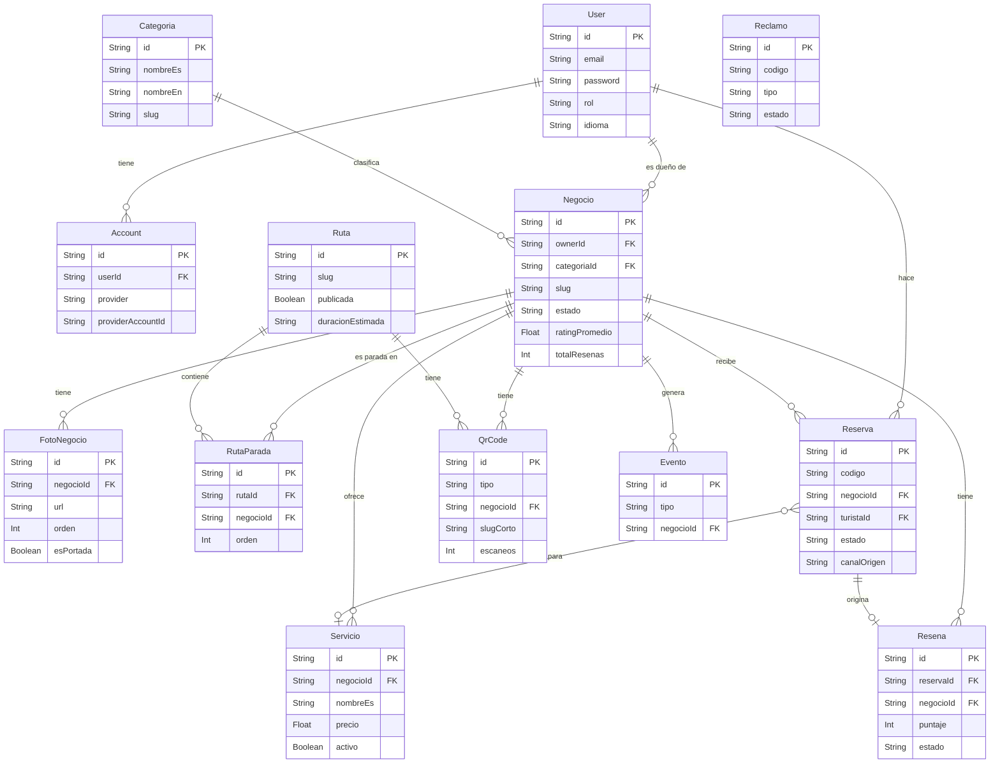

# RutaMisti

Plataforma web para descubrir y reservar en negocios turísticos locales de Arequipa, Perú. Conecta picanterías, artesanos, talleres de cocina y guías locales con turistas que deciden desde el celular.

---

## Stack

| Capa | Tecnología | Versión |
|------|-----------|---------|
| Framework | Next.js (App Router) | 16.4.6 |
| Lenguaje | TypeScript | 5.9 |
| Estilos | Tailwind CSS v4 + shadcn/ui | 4.3.3 |
| Base de datos (dev) | SQLite vía Prisma | — |
| Base de datos (prod) | PostgreSQL / Supabase | — |
| ORM | Prisma | 5.22.0 |
| Autenticación | Auth.js v5 (next-auth beta) | 5.0.0-beta.32 |
| i18n | next-intl | 4.15.1 |
| Validación | Zod | 4.x |
| Formularios | React Hook Form + Zod resolver | 7.x |
| Mapas | Leaflet + react-leaflet | — (fase 4) |
| QR | qrcode | 1.5.4 |
| Gestor de paquetes | pnpm | 12.18.0 |
| Deploy | Vercel + Supabase | — |

---

## Cómo correr en local

### Requisitos previos

- Node.js >= 24.0
- pnpm: `curl -fsSL https://get.pnpm.io/install.sh | sh -`

### Pasos

```bash
# 1. Clonar el repositorio
git clone <repo-url>
cd RutaMisti

# 2. Instalar dependencias
pnpm install

# 3. Configurar variables de entorno
cp .env.example .env.local
# Editar .env.local con tus valores

# 4. Aplicar migraciones y crear la base de datos
DATABASE_URL="file:./prisma/dev.db" pnpm prisma migrate dev

# 5. Cargar datos de prueba
pnpm db:seed

# 6. Levantar el servidor de desarrollo
pnpm dev
```

La app estará en `http://localhost:3000`. Redirige automáticamente a `/es`.

---

## Variables de entorno

Archivo: `.env.local` (no commitear — está en `.gitignore`)

```env
# Base de datos SQLite (desarrollo)
DATABASE_URL="file:./prisma/dev.db"

# Secreto para Auth.js — generar con: openssl rand -base64 32
AUTH_SECRET="tu-secreto-aqui"

# URL base
NEXTAUTH_URL="http://localhost:3000"
NEXT_PUBLIC_SITE_URL="http://localhost:3000"
```

Para producción con Supabase:

```env
DATABASE_URL="postgresql://postgres:[password]@[host]:5432/postgres"
NEXT_PUBLIC_SUPABASE_URL="https://[project].supabase.co"
NEXT_PUBLIC_SUPABASE_ANON_KEY="..."
SUPABASE_SERVICE_ROLE_KEY="..."   # solo servidor, nunca exponer al cliente
```

---

## Estructura de carpetas

```
/
├── app/
│   ├── [locale]/               # Rutas con prefijo de idioma (/es, /en)
│   │   ├── layout.tsx          # Layout raíz: fuentes, NextIntlClientProvider
│   │   ├── globals.css         # Variables CSS de paleta, Tailwind v4
│   │   ├── page.tsx            # Home pública
│   │   ├── (public)/           # Explorar, perfiles, rutas, reservas
│   │   ├── (auth)/             # /ingresar, /registro, /recuperar
│   │   ├── panel/              # Dashboard del negocio (protegido)
│   │   └── admin/              # Panel admin (solo rol=admin)
│   └── api/
│       ├── auth/[...nextauth]/ # Route handler de Auth.js
│       ├── negocios/           # JSON público para el mapa
│       └── qr/[tipo]/[slug]/   # Genera PNG/SVG del QR
├── components/
│   ├── layout/                 # Header, Footer
│   ├── ui/                     # Componentes shadcn/ui
│   ├── negocio/                # Cards, galería, horario
│   ├── ruta/                   # Cards y mapa de rutas
│   ├── reserva/                # Formulario, estado
│   └── mapa/                   # Wrapper de Leaflet
├── lib/
│   ├── prisma.ts               # Cliente Prisma singleton
│   └── auth.ts                 # Configuración Auth.js: providers, callbacks, roles
├── i18n/
│   ├── routing.ts              # defineRouting: locales, defaultLocale
│   └── request.ts              # getRequestConfig: carga messages según locale
├── messages/
│   ├── es.json                 # Textos en español
│   └── en.json                 # Textos en inglés
├── prisma/
│   ├── schema.prisma           # Modelo de datos completo
│   ├── migrations/             # Migraciones SQL generadas por Prisma
│   ├── seed.ts                 # Datos de prueba (fase 2)
│   └── dev.db                  # Base de datos SQLite (ignorada en git)
├── middleware.ts                # i18n routing + protección /panel y /admin
├── next.config.ts              # withNextIntl, turbopack, remotePatterns
├── .env.example                # Template de variables de entorno
├── DECISIONES.md               # Registro de decisiones técnicas
└── README.md                   # Este archivo
```

---

## Modelo de datos



---

## Roles de usuario

| Rol | Acceso | Cómo se asigna |
|-----|--------|----------------|
| `turista` | Explorar, reservar, reseñar (sin cuenta obligatoria) | Default al registrarse |
| `negocio` | Panel `/panel`: gestionar perfil, reservas, QR | Admin lo eleva |
| `admin` | Panel `/admin`: aprobar negocios, moderar, métricas | Seed inicial o SQL directo |

---

## Rutas principales

| Ruta | Descripción | Requiere auth |
|------|-------------|---------------|
| `/es` | Home pública | No |
| `/es/explorar` | Listado + filtros + mapa | No |
| `/es/negocio/[slug]` | Perfil del negocio | No |
| `/es/rutas` | Listado de rutas temáticas | No |
| `/es/rutas/[slug]` | Detalle de ruta con mapa | No |
| `/es/reservar/[slug]` | Formulario de reserva | No |
| `/es/reserva/[codigo]` | Estado de la reserva | No |
| `/es/resena/[codigo]` | Dejar reseña verificada | No |
| `/es/ingresar` | Login | No |
| `/es/panel/**` | Dashboard del negocio | Sí (negocio o admin) |
| `/es/admin/**` | Panel admin | Sí (solo admin) |

---

## Scripts disponibles

| Comando | Descripción |
|---------|-------------|
| `pnpm dev` | Servidor de desarrollo (Turbopack) en `localhost:3000` |
| `pnpm build` | Build de producción |
| `pnpm start` | Servidor de producción |
| `pnpm lint` | Lint con ESLint |
| `pnpm db:seed` | Cargar datos de prueba en la DB |
| `pnpm db:reset` | ⚠️ **Solo dev** — resetea la DB y re-seedea desde cero |
| `pnpm db:studio` | Abrir Prisma Studio (UI para inspeccionar la DB) |

---

## Componentes UI disponibles (shadcn/ui)

Instalados en `components/ui/`:

`Avatar` · `Badge` · `Button` · `Card` · `Dialog` · `Dropdown Menu` · `Input` · `Label` · `Select` · `Separator` · `Sheet` · `Skeleton` · `Sonner (toasts)` · `Tabs` · `Textarea` · `Toast`

Agregar más con: `pnpm dlx shadcn@latest add <nombre>`

---

## Estado del proyecto

| Fase | Descripción | Estado |
|------|-------------|--------|
| 1 | Setup: Next.js, Tailwind, Prisma, Auth.js, next-intl, layout base | ✅ Completa |
| 2 | shadcn/ui + seed de datos de prueba | 🔄 En progreso |
| 3 | Auth: páginas login, registro, recuperación | ⏳ Pendiente |
| 4 | Vistas públicas: Home completo, Explorar, Perfil, Rutas | ⏳ Pendiente |
| 5 | Reservas: formulario, código, estado, WhatsApp | ⏳ Pendiente |
| 6 | Panel del negocio: wizard, dashboard, reservas, fotos, QR | ⏳ Pendiente |
| 7 | Reseñas verificadas + respuestas del negocio | ⏳ Pendiente |
| 8 | Panel admin: aprobación, rutas, moderación, reclamaciones | ⏳ Pendiente |
| 9 | SEO, JSON-LD, sitemap, legales, analítica | ⏳ Pendiente |
| 10 | Tests (Vitest + Playwright) + deploy Vercel | ⏳ Pendiente |

---

## Paleta de colores

| Variable CSS | Hex | Uso |
|---|---|---|
| `--primary` | `#16708e` | Color principal, links, botones |
| `--primary-dark` | `#0f5670` | Header, footer, hover |
| `--accent` | `#3db5d0` | Acentos, íconos activos |
| `--yellow` | `#f8c81c` | CTAs secundarios, estrellas |
| `--bg-light` | `#e1f2f7` | Fondos de secciones |
| `--text` | `#1d2b36` | Texto principal |
| `--whatsapp` | `#25d366` | Botón WhatsApp |
